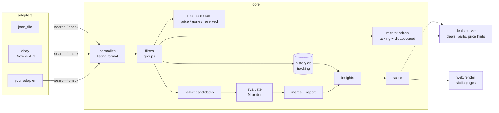

# deal-engine

A small, self-hosted engine for finding second-hand deals: it collects listings from sources you
connect, keeps a state per search (new listings in, gone listings out, price changes), estimates
market prices from asking prices and from listings that disappear, lets an LLM evaluate new
candidates, and turns the evaluator's numbers into a score with profit, profit per hour and a
negotiation hint. A static page per search and a small deal/parts tracker show the result.

It started as a private tool for repairing and reselling used electronics. This repository is
the platform-neutral core of it: **no scrapers are included**. Listings come in through
adapters; two ship with it — the official eBay Browse API and a plain JSON file.


## Quick start (demo, no accounts or keys needed)

```sh
pip install -r requirements.txt
make demo
```

`make demo` generates an invented market (nothing in it comes from a real marketplace),
simulates 21 days with new listings, price cuts, reservations and listings that disappear, runs
the full pipeline once per simulated day with a rule-based stand-in for the LLM, seeds the deal
list, and serves everything on <http://127.0.0.1:8081/>:

- <http://127.0.0.1:8081/electronics/> – search page
- <http://127.0.0.1:8081/deals/> – deals, parts and purchases

Run the tests with `make test`.


## How it works



One run of a search (`python -m core run electronics`) does, per adapter:

1. **collect** (`core/pipeline.py`): run the configured queries, normalize every result into the
   [listing format](docs/listing-format.md), refresh market prices per group (at most once per
   `refresh_hours`), record everything in the tracking database, compare the stored listings with
   the results (price changes, reserved, gone via `check()`), and pick new candidates: they must
   pass the filters, not be known, and be cheap enough relative to the market median
   (`flip_ratio` for working units, `defect_price_ratio` for defective ones).
2. **prefilter** (optional): a cheap model drops obvious junk.
3. **evaluate**: the LLM reads the candidate batch (including downloaded photos) and writes
   its evaluation: resale price, parts, hours, risk, photo check, questions for the seller.
4. **merge**: accepted listings go into the state, a markdown report lists new / price changes /
   gone / reserved.

Then for the whole search: **classify** (optional, LLM assigns titles to market groups),
**insights** (time online, price drops, relisted items, sale price from disappeared listings,
bundles), **score**, **render**.

### Modules

| Path | Content |
|---|---|
| `core/listing.py` | listing model, validation and normalization ([format](docs/listing-format.md)) |
| `core/filters.py` | hard filters (`passes`) and defect signal |
| `core/groups.py` | market groups: `match_group`, `bundle_qty`, `market_group`, accessories |
| `core/market.py` | market price estimate from asking prices, resale estimates, sale price from disappeared listings |
| `core/history.py` | price tracking in SQLite, checks of listings that vanished from the results |
| `core/insights.py` | time online, price drops, relisted, market data and bundle prices per stored listing |
| `core/score.py` | score formula, price ceiling, negotiation hint, message draft |
| `core/classify.py` | optional LLM group assignment |
| `core/pipeline.py` | collect / prefilter / merge (adapter-neutral) |
| `core/run.py`, `core/__main__.py` | orchestration and CLI |
| `core/prompts/` | generic evaluation and prefilter prompts |
| `profiles/electronics.md` | example search profile (criteria and fields for the evaluator) |
| `adapters/` | `base.py` (interface), `json_file.py`, `ebay.py` |
| `deals/` | deal list, parts inventory, purchases, listing price hints |
| `web/render.py` | static page per search (only an electronics page is included as an example) |
| `demo/` | market simulator, demo evaluator, deal seeding |

### The score

`core/score.py` computes, from the evaluator's numbers:

- profit = resale − purchase − parts − shipping (or pickup: km × cost, driving time counts as work)
- expected profit = success probability (by risk and photo check) × profit − failure probability × loss
- base score from expected profit per hour (piecewise linear), bonus for high absolute profit
- caps: high risk, fraud indicators (negated mentions such as "no signs of fraud" are ignored),
  photos worse than described, no market data, reserved, and never more than one point above the
  evaluator's own score
- the highest purchase price that still reaches `target_score` (used for the negotiation hint)

All weights are configurable (`score:` in a search, `shipping:` globally).

## Configuration

Copy `config.example.yaml` to `config.yaml`. It holds your location (for distances and shipping
estimates – the example values are a placeholder), the shipping model and fees, LLM settings,
and one block per search: adapters, filters, market groups, score parameters.

```sh
python -m core run                    # all searches, evaluation with the Claude Code CLI
python -m core run electronics        # one search
python -m core score electronics --show
python -m core history electronics    # tracking statistics per group
python -m core validate listings.json # check a listings file
python -m deals.deals_server --web-root data/web
```

The LLM steps call the [Claude Code](https://docs.claude.com/en/docs/claude-code) CLI in print
mode (`claude -p`) with only the Read/Write tools, because the evaluator has to read the
candidate file and photos and write one result file. Command and arguments are configurable
under `llm:`. Each call gets `--tools` (only Read/Write exist for the evaluator, no tools for
classification), `--allowedTools` and, by default, `--strict-mcp-config --mcp-config '{"mcpServers": {}}'`
so that no MCP servers are loaded. Your own Claude Code settings and hooks still apply to these
runs. If the CLI is not available, the evaluation step fails and is reported as a problem in the
run report; collecting, tracking and market prices still work.

What has actually been run (Claude Code 2.1.310, model `haiku`, 5 defective demo listings, no
photos): evaluation of a batch of 3 candidates (about 35–55 s) and classification of 5 titles
(about 13 s), twice; the result files were valid JSON both times and were merged into the state.
Larger batches, photos and other models have not been tried in this repository.

## Data sources

deal-engine does not fetch anything by itself; adapters do. **You are responsible for making
sure that your use of any data source complies with its terms of service, its API license,
robots rules and the law that applies to you** (including copyright, database rights and data
protection). In particular:

- Prefer official APIs and feeds over anything else.
- Do not work around access restrictions: no captcha solving, no evasion of rate limits or bot
  protection, no logins you are not entitled to, no rotating identities.
- Keep request volumes low; the adapter interface is built around a few queries per run.
- Store item data only. Do not collect personal data of sellers; the listing format has no
  fields for it.

Adapters for platforms without an official API are out of scope for this repository.

### eBay

`adapters/ebay.py` uses the official [Browse API](https://developer.ebay.com/api-docs/buy/browse/overview.html)
with an application token (client credentials). You need your **own** key set from the eBay
Developers Program (`EBAY_CLIENT_ID`, `EBAY_CLIENT_SECRET` in the environment), and your use must
comply with the **eBay API License Agreement** and the call limits of your key. The adapter
stores item data only (title, price, condition, shipping cost, item location, item number,
description, images, item aspects) and no user data (no seller name, user id or feedback).
Without credentials the adapter stops with an error; there is no fallback to anything else.

Live check (writes nothing; credentials only from the environment):

```sh
python -m adapters.ebay "your search" --markets EBAY_DE --limit 5 [--country DE --zip 10115]
```

It requests a token, runs one search per marketplace, prints the items, and calls getItem and
`check()` for the first one.

**Verified against the live API on 2026-10-26** with this probe (EBAY_AT and EBAY_DE, 5 items
each): the client-credentials token, the search on both marketplaces (5 items each, with price,
shipping cost, condition and item location), getItem for one item (description, 6 images,
9 aspects, item location) and `check()` (returned `active`) all worked, with 4 API requests
in total. A full `python -m core run` with the eBay adapter (state, candidates, evaluation) has
not been run against the live API.

Shipping costs: in that probe, 2 of 10 items had no shipping cost in the search result. A missing
cost is treated as unknown, never as 0: the item is marked `shipping_unknown` with the note
"shipping unknown, assumed 15 €", and `shipping.unknown_cost` (default 15 €) is used for the
candidate selection and the score. A stated cost of 0 counts as free shipping.

### Your own adapter

Implement `search(query)` and `check(source_id)` (see `adapters/base.py`), return listings in
the [listing format](docs/listing-format.md), register the class in `adapters/__init__.py`.

## Limitations

- **Asking prices are not sale prices.** The market estimate is a median of asking prices,
  reduced by `sale_factor`. The "sale price" from disappeared listings is an assumption, too:
  a listing that disappears may have been sold, but also deleted or relisted elsewhere.
- **The score is a heuristic.** It is only as good as the evaluator's numbers (resale price,
  parts, hours, risk), and its weights reflect one person's repair-and-resell use case.
- **Regex rules are language- and market-specific.** Groups, filters, accessory and bundle
  detection come with English defaults and have to be adapted to your market.
- **LLM evaluations can be wrong**, also on photos, and differ between runs (the same 3 demo
  candidates: 1 of 3 accepted in one `haiku` run, 0 of 3 in the next). The automated tests use a fake
  command; the real CLI was only run manually as described above.
- The eBay adapter is verified only with the probe described above (token, search, getItem,
  check), not in a full pipeline run against the live API.
- Without a photo URL, relist detection is text-based (same source and place, same group, price
  within ±15 %, similar title). Two different items with generic titles from the same place can
  still be taken for one.
- The deal server has no authentication and binds to 127.0.0.1. Put authentication in front of
  it before exposing it anywhere.

## License

MIT, see [LICENSE](LICENSE).
