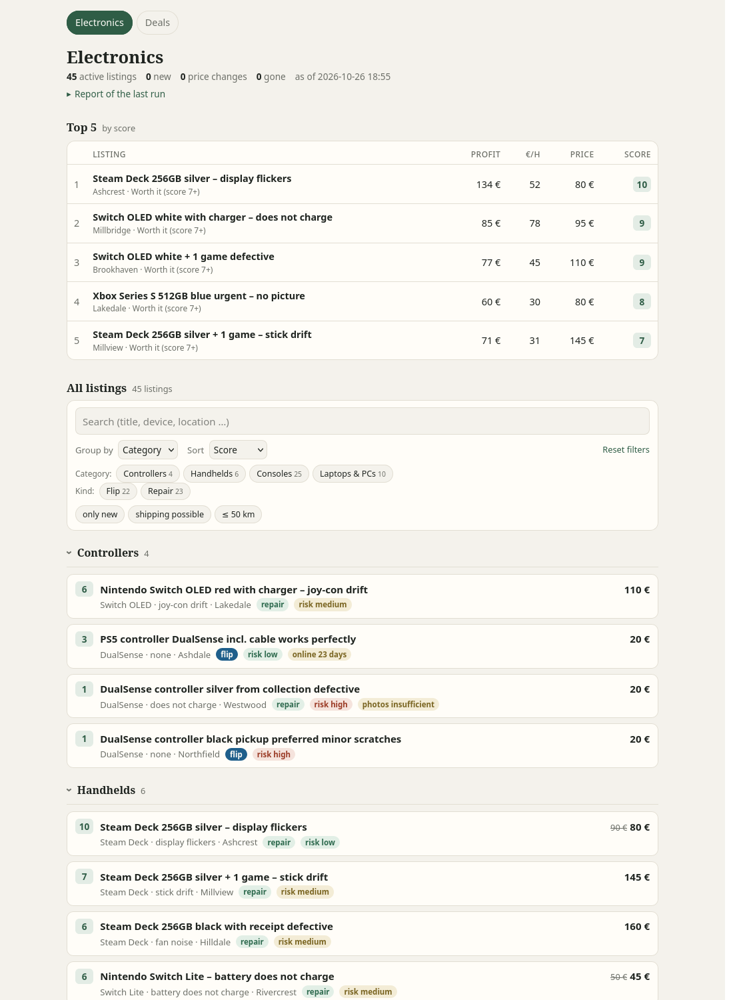
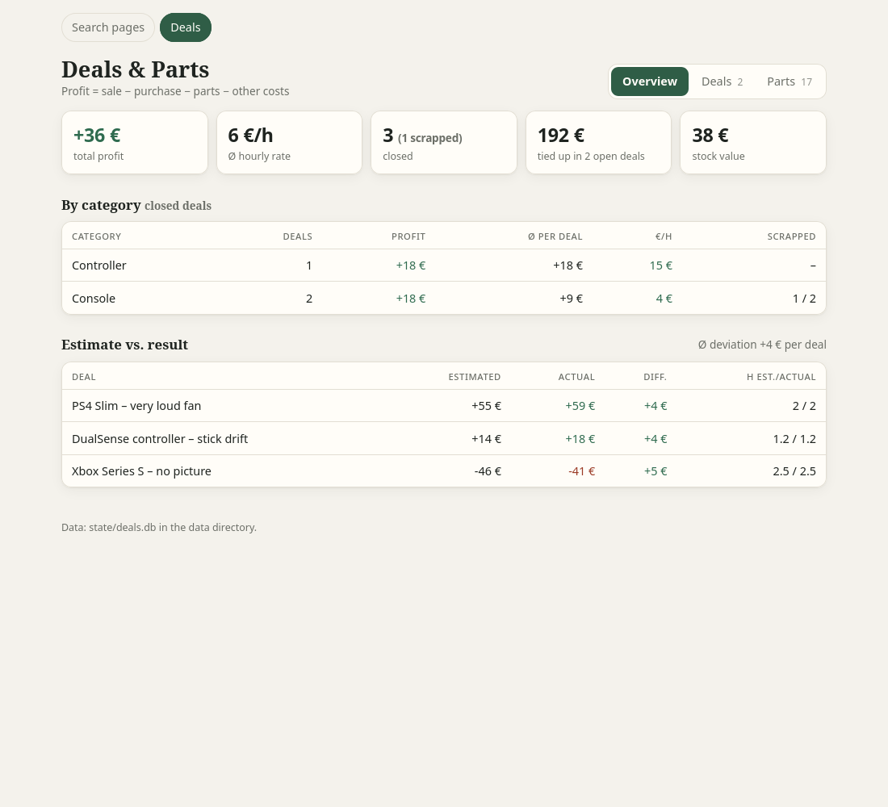
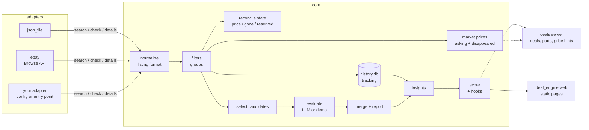

# deal-engine

A small, self-hosted engine for finding second-hand deals: it collects listings from sources you
connect, keeps a state per search (new listings in, gone listings out, price changes), estimates
market prices from asking prices and from listings that disappear, lets an LLM evaluate new
candidates, and turns the evaluator's numbers into a score with profit, profit per hour and a
negotiation hint. A static page per search and a small deal/parts tracker show the result.

It started as a private tool for repairing and reselling used electronics. This repository is
the platform-neutral core of it: **no scrapers are included**. Listings come in through
adapters; two ship with it — the official eBay Browse API and a plain JSON file. Your own
adapters, filters, language, prompts, page layout and score adjustments plug in from the outside
(see [Extending deal-engine](#extending-deal-engine)).



## Quick start (demo, no accounts or keys needed)

```sh
pip install -r requirements.txt
make demo
```

`make demo` generates an invented market (nothing in it comes from a real marketplace),
simulates 21 days with new listings, price cuts, reservations and listings that disappear, runs
the full pipeline once per simulated day with a rule-based stand-in for the LLM, seeds the deal
list, and serves everything on <http://127.0.0.1:8081/>:

- <http://127.0.0.1:8081/electronics/> – search page
- <http://127.0.0.1:8081/deals/> – deals, parts and purchases

`make demo-de` runs the same demo with the German locale into `data/demo-de` (it does not start
the server; `make serve-demo-de` serves it, deal list in German). Run the tests with `make test`.



## Installation

Python 3.9 or newer; the only runtime dependency is PyYAML.

**From the repository** (demo, tests, your own changes):

```sh
git clone https://github.com/robinw0410/deal-engine.git
cd deal-engine
pip install -r requirements.txt   # PyYAML, and pytest for the tests
make demo
```

Everything lives in the `deal_engine` package. Run the commands from the repository directory;
there `deal_engine` is importable without installing it.

**As a package**, from a release tag:

```sh
pip install "deal-engine @ git+https://github.com/robinw0410/deal-engine@v0.2.16"
```

This installs the `deal_engine` package including the built-in prompts and the deal list page.
`config.example.yaml`, `profiles/` and the `Makefile` are not part of the package: copy
`config.example.yaml` (as `config.yaml` for your own searches) and the profile it references
(`profiles/electronics.md`) from the repository into your working directory.

`python -m deal_engine …` (also `deal_engine.deals.deals_server` and `deal_engine.demo.run_demo`)
takes the config from the **current working directory** (`./config.yaml`, then
`./config.example.yaml`) unless `--config PATH` or `$DEAL_ENGINE_CONFIG` says otherwise; see
[Configuration](#configuration). The demo without `make`, from a directory that contains
`config.example.yaml`:

```sh
python -m deal_engine.demo.run_demo --days 21 --quiet --data data/demo
DEAL_ENGINE_DATA_DIR=data/demo python -m deal_engine.deals.deals_server --config config.example.yaml --port 8081 --web-root data/demo/web
```

## How it works



One run of a search (`python -m deal_engine run electronics`) does, per adapter:

1. **collect** (`deal_engine/core/pipeline.py`): run the configured queries, normalize every
   result into the [listing format](docs/listing-format.md), refresh market prices per group (at
   most once per `refresh_hours`), record everything in the tracking database, compare the stored
   listings with the results (price changes, reserved, gone via `check()`), and pick new
   candidates: they must pass the filters, not be known, and be cheap enough relative to the
   market median (`flip_ratio` for working units, `defect_price_ratio` for defective ones).
   With the LLM evaluator and `classify` enabled, the titles of the possible candidates are
   classified by a small model **before** this selection (see [Market groups](#market-groups)).
2. **prefilter** (optional): a cheap model drops obvious junk.
3. **evaluate**: the LLM reads the candidate batch (including downloaded photos) and writes
   its evaluation: resale price, parts, hours, risk, photo check, questions for the seller.
4. **merge**: accepted listings go into the state, a markdown report lists new / price changes /
   gone / reserved.

Then for the whole search: **classify** (optional, LLM assigns titles from tracking and the state to market groups),
**insights** (time online, price drops, relisted items, sale price from disappeared listings,
bundles), **score**, **render**.

### Modules

| Path | Content |
|---|---|
| `deal_engine/core/listing.py` | listing model, validation, normalization, extra fields ([format](docs/listing-format.md)) |
| `deal_engine/core/filters.py` | hard filters (`passes`, numeric `fields` filters) and defect signal |
| `deal_engine/core/groups.py` | market groups: `match_group`, `bundle_qty`, `market_group`, accessories, `games_count` |
| `deal_engine/core/market.py` | market price estimate from asking prices (`market.sample`), resale estimates, sale price from disappeared listings, `sample_report` |
| `deal_engine/core/history.py` | price tracking in SQLite, checks of listings that vanished from the results |
| `deal_engine/core/insights.py` | time online, price drops, relisted, market data and bundle prices per stored listing |
| `deal_engine/core/score.py` | score formula, price ceiling, negotiation hint, message draft, score hooks |
| `deal_engine/core/classify.py` | optional LLM group assignment |
| `deal_engine/core/pipeline.py` | collect / prefilter / merge (adapter-neutral) |
| `deal_engine/core/run.py`, `deal_engine/__main__.py` | orchestration (`RunResult`) and CLI |
| `deal_engine/core/config.py` | config loading, path resolution, `ConfigError` |
| `deal_engine/core/locale.py` | language rules and texts (`en`, `de`) |
| `deal_engine/core/plugins.py` | loading `"module:attribute"` plugins and entry points |
| `deal_engine/core/llm.py` | Claude Code CLI calls and prompt loading |
| `deal_engine/core/prompts/<locale>/` | built-in `evaluate`, `prefilter` and `classify` prompts (`en`, `de`) |
| `profiles/electronics.md` | example search profile (criteria and fields for the evaluator) |
| `deal_engine/adapters/` | registry (`__init__.py`), `base.py` (interface), `json_file.py`, `ebay.py` |
| `deal_engine/deals/` | deal list, parts inventory, purchases, listing price hints |
| `deal_engine/web/render.py` | static page per search, layout from `searches.<name>.web` |
| `deal_engine/demo/` | market simulator, demo evaluator, deal seeding |

### The score

`deal_engine/core/score.py` computes, from the evaluator's numbers:

- profit = resale − purchase − parts − shipping (or pickup: km × cost, driving time counts as work)
- expected profit = success probability (by risk and photo check) × profit − failure probability × loss
- base score from expected profit per hour (piecewise linear), bonus for high absolute profit
- caps: high risk, fraud indicators (negated mentions such as "no signs of fraud" are ignored),
  photos worse than described, no market data, reserved, and never more than one point above the
  evaluator's own score
- the highest purchase price that still reaches `target_score` (used for the negotiation hint)

All weights are configurable (`score:` in a search, `shipping:` globally). Score hooks can adjust
the result afterwards (see [Score hooks](#score-hooks)).

## Configuration

Copy `config.example.yaml` to `config.yaml`. It holds your location (for distances and shipping
estimates – the example values are a placeholder), the shipping model and fees, LLM settings,
and one block per search: adapters, filters, market groups, score parameters, page layout.

The config is looked up as `--config PATH`, `$DEAL_ENGINE_CONFIG`, `./config.yaml`,
`./config.example.yaml` (`./` is the current working directory). Relative paths inside it
(`data_dir`, `profile`, `json_file.path`, `prompts`, `plugin_paths`, `web.root`) are relative to
the config file; `{data_dir}` expands to the data directory.

```sh
python -m deal_engine run                    # all searches, evaluation with the Claude Code CLI
python -m deal_engine run electronics        # one search
python -m deal_engine run --json result.json # also write the structured results
python -m deal_engine score electronics --show
python -m deal_engine render                 # render the search pages
python -m deal_engine history electronics    # tracking statistics per group
python -m deal_engine market-sample electronics   # market median: word rules against classified devices
python -m deal_engine validate listings.json # check a listings file
python -m deal_engine adapters               # adapters this config can use, and where they come from
python -m deal_engine --config my.yaml run   # --config goes before the command
python -m deal_engine.deals.deals_server --web-root data/web
```

`--web-root` of the deal server is relative to the working directory; `--locale en|de` overrides
the config locale for the deal list and price hints.

The LLM steps call the [Claude Code](https://docs.claude.com/en/docs/claude-code) CLI in print
mode (`claude -p`) with only the Read/Write tools, because the evaluator has to read the
candidate file and photos and write one result file. Command and arguments are configurable
under `llm:`. Each call gets `--tools` (only Read/Write exist for the evaluator, no tools for
classification), `--allowedTools`, by default `--strict-mcp-config --mcp-config '{"mcpServers": {}}'`
so that no MCP servers are loaded, and always `--disallowedTools Bash WebFetch WebSearch`, whatever
`llm.extra_args` say; `extra_args` that allow one of these tools with `--tools`/`--allowedTools` are
a configuration error, and so are `--dangerously-skip-permissions`,
`--allow-dangerously-skip-permissions` and `--permission-mode bypassPermissions` in
`llm.extra_args` or `llm.command` (any spelling), as well as `--settings` (a settings file could
set `permissions.defaultMode: bypassPermissions`). These flags are matched as literal tokens of
the arguments, so a harmless text argument that contains one of them is rejected too. Your own Claude Code settings and hooks still apply to these runs. As a
second line of defence, deny these tools in the Claude Code settings of the user that runs
deal-engine (e.g. a service user), `~/.claude/settings.json`:

```json
{"permissions": {"deny": ["Bash", "WebFetch", "WebSearch"]}}
```

If the CLI is not available, the evaluation step fails and is reported as a problem in the
run report; collecting, tracking and market prices still work.

What has actually been run (Claude Code 2.1.310, model `haiku`, 5 defective demo listings, no
photos): evaluation of a batch of 3 candidates (about 35–55 s) and classification of 5 titles
(about 13 s), twice; the result files were valid JSON both times and were merged into the state.
Larger batches, photos and other models have not been tried in this repository. This was done
with 0.1.x and has **not been re-run since**: not for 0.2.0 (new package layout, prompts moved to
`deal_engine/core/prompts/<locale>/`, German prompts), not for 0.2.1 (`--disallowedTools` on
every call) and not for 0.2.2 (classification before the candidate selection). The command lines are covered by the automated tests with a fake command.

### Market groups

`market.groups` of a search is an ordered list. A listing title belongs to the **first** group
whose `match` regex hits and whose `exclude` regex does not; an excluded title falls through to
the later groups. All regexes are case-insensitive.

```yaml
groups:
  - {name: DualSense, keyword: dualsense, match: "dualsense", exclude: "edge|console", min: 20, max: 90}
  - {name: PS5, keyword: ps5, match: "\\bps5\\b", exclude: "pro|slim", veto: "headset|camera|^\\W*(ps5\\s+)?dualsense", min: 200, max: 650}
```

`veto` (optional, since 0.2.2) stops the fall-through: if a group's `match` and its `veto` both
hit, the title gets **no group at all**, whatever later groups say. Use it for accessories and
other products whose titles contain the device name of a broad group ("PS5 headset", "DualSense
for PS5 console" after the DualSense group excluded it, "Switch 2 controller" when there is no
Switch 2 group). A title the word rules cannot place is not compared with any market price.

Accessories of a group (accessory words of the locale, or `market.accessory_regex`) are skipped,
bundles of controller-like groups are compared with quantity × the unit median. A device listed
with extras that carry their own value ("Konsole mit 6 Spielen", "console + Zelda"; the locale's
`bundle_extras` after a with-word, not after "ohne"/"without") is a normal candidate of its group
but not counted as a single unit in the market statistics (since 0.2.5).

Extras with their own market group raise the **candidate threshold** of a device (since 0.2.6):
`extras: {"<group>": "<regex counting its units>"}` on a group, e.g. on a console
`extras: {"Controller": "controller\\w*|gamepads?"}`. The threshold becomes
(device median + n × that group's median) × ratio, n counted from the title ("+ 2 Controller" = 2,
"+ Controller" = 1, "mit zwei Controllern" = 2; "ohne Controller" and "Controller-Ladestation" = 0,
at most 8; every listed unit counts here, while the bundle adjustment of the market statistics
deducts only the additional ones, see [Market prices](#market-prices)). Extras without market data
and anything no group covers add nothing (games: 0 €, or
a flat value with `market.game_value`, see [Market prices](#market-prices)). Only
the candidate selection uses it, and since 0.2.8 `market_resale_estimate` includes n × the extra
group's resale estimate (same sale_factor logic), so the score's resale cap counts the extras too
and `score_calc` names them when that cap applies ("inkl. 2 × DualShock 4 à 26 €"); the evaluation
prompt says they are already in the estimate; the market statistics are unchanged.
The candidate (and the stored listing, refreshed on every run) carries `market_extras`
(`[{group, count, median, resale}]`), which the evaluation sees as plain input; it is not shown on the page.
A unit followed by "fehlt", "defekt", "Drift" etc. counts 0, a model number ("DualShock 4
Controller") is no count, and "2 Controller (1 defekt)" counts 1.

With `classify` enabled (`classify: {enabled: true, model: haiku, max_per_run: 600, batch: 150}`)
and the LLM evaluator (`claude`), `collect` asks the classification model about the titles of the
listings it is about to consider as candidates **before** selecting them: only titles that some
group's `match` regex hits (also excluded or vetoed ones), each listing only once (stored in
`history.db`, table `classify`, key `<adapter>-<source_id>`). After the merge, titles from tracking
and the state that the word rules place in a group are classified as well. `max_per_run` is the
limit for one search run: all adapters and the step after the merge share it (each model call
still has a 10-minute timeout); with `market.sample: device_only` the bundles noted by the group
queries count against it too.

A stored result is only used when it is **plausible**: a group named by the model must have a
`match` regex that hits the title, and that group's `veto` must not hit it (`exclude` is ignored
for this check, so the model may place "DualSense for PS5 console" in DualSense, but never
"DualSense" in PS5, nor a title in a group whose veto rules it out). Then it replaces
the word rules for that listing — in the candidate selection, in tracking (`listing.grp`) and in
the insights: `device`/`bundle` → that group (and quantity for controller-like groups),
`accessory` → skipped / no group, `part` → see [Spare parts](#spare-parts), `other` → no group, no
market comparison. Tracking keeps this
decision on later runs (the word-rule group does not come back). An implausible result, no
result, or an unavailable model (logged, the run goes on) leaves the word rules in effect. With a
callable evaluator (demo, tests) no model is called.

Group regexes (`match`, `exclude`, `veto`) are checked when a search is loaded; an invalid one is
a configuration error.

### Market prices

Per group, `collect` runs the group's `keyword` query (at most once per `refresh_hours`) and stores
median, 25th percentile and sample size of the working single units in
`data/state/<search>-market.json`. Listings with the defect signal, titles hit by the locale's
`market_exclude` words (or `market.exclude_regex`) and prices outside the group's `min`/`max` never
count; fresh listings are preferred (`fresh_days`, `min_fresh`), then private sellers
(`min_private`), and below `min_n` listings there is no new value (the previous one is kept).

`market.sample` decides which of the remaining listings count:

| `sample` | counted |
|---|---|
| `all` (default) | what the word rules call a single unit of the group: no accessory, no bundle quantity, no games after a with-word. Unchanged from earlier versions. |
| `device_only` | only listings the stored LLM classification (table `classify`, see [Market groups](#market-groups)) calls `device` with quantity 1 of **this** group, and plausibly so. Bundles, accessories, parts, `other` and listings that are **not classified yet** do not count. |

Why: the word rules only see bundles that say so ("mit 6 Spielen"). A console listed with a second
controller and a game without a with-word counts as a single unit and pulls the median up (for
example devices 150 €, bundles 180 €, both together 167 €), and games or accessories the rules
miss count along.

```yaml
market:
  sample: device_only   # default: all
  device_min_n: 8       # with fewer single devices, adjusted bundles are added
  game_value: 5         # flat value per game (€)
  game_value_max: 30    # at most this much for the games of one listing
  games_default: 2      # "mit Spielen" without a count
```

The numbers are checked when a search is loaded: `device_min_n` and `games_default` must be
integers ≥ 0, `game_value` and `game_value_max` numbers ≥ 0 (`game_value_max: null` = no maximum);
anything else, also an empty value, is a configuration error.

- **No model call at the market update.** `update_market` only reads the stored classification
  (`history.attach_classification`, read-only, item field `_cls`); a missing or unreadable
  `history.db` means "nothing classified" and the previous values stay. The titles of the group
  queries are classified after the run like all tracked titles, so this needs `track: true`,
  `classify` enabled and the LLM evaluator. A new group therefore gets its first value at the
  second market update (usually the next day), once at least `min_n` of its listings are
  classified as devices; until then it has none, or keeps the one computed with `all`.
- **A device with games stays a bundle.** If the classification says `device` but the title lists
  games after a with-word (`has_extras`), the listing is treated as a bundle.
- **Bundles the word rules recognise** ("PS4 mit 3 Spielen", "Switch + Zelda": `has_extras`) are
  not tracked by the word rules, so nothing would ever classify them. With `device_only` the group
  queries therefore **note** them in `history.db` (`history.track(..., earmark_bundles=True)`: a
  title of a group with a price, without defect signal, not an accessory, spare part or bundle
  quantity by the word rules, not hit by `market_exclude`), and the step after the merge classifies
  them like every tracked title. What follows from that:
  - They are stored **without a group** (`listing.grp` NULL) and stay that way: with `device_only`
    a title with extras never gets a tracking group, also when the model calls it a `device` or
    `bundle` of one (`history.bundles_apart`; applies to `history.track` and
    `classify.correct_tracking`). So they count only through table `classify` in the bundle
    fallback below and in `sample_report`, never in the statistics of disappeared listings
    (`sold_by_group`, the sale price in the insights) and not for the text-based relist detection.
    A bundle only the model sees ("Konsole Set komplett") keeps its group as before, and with
    `sample: all` nothing changes at all.
  - They cause **no extra requests**: `check_gone` skips bundles without a group, so they are
    never checked one by one and stay `active` with their `last_seen` (`history stats` shows them
    in the row without group).
  - They **share `classify.max_per_run`** with all other titles of the run. With many bundles in
    the group queries, the first runs after switching to `device_only` classify fewer other titles
    (the rest follows on the next runs).
- **Adjusted bundles.** With fewer than `device_min_n` single devices, bundles of the group
  (classification `bundle` with quantity 1, or such a device with games) are added at their price
  minus the extras: the **additional** units of every `extras` group of the device group × that
  group's asking median (see [Market groups](#market-groups); the median just computed in this
  update, otherwise the previous one — groups are computed in the order this needs) and the flat
  value of the games. One unit of an extras group belongs to the device (a console comes with a
  controller): "PS4 mit 2 Controllern" at 180 € counts as 180 − 1 × the controller median, "PS4 mit
  Controller" deducts nothing. `extras_included` on the device group changes that number (`0`, or
  per extras group `{"Pro Controller": 0}` for an extra that never comes with the device). The
  adjusted price must be above 0 and within the group's `min`/`max`. A bundle with nothing to
  deduct, or with additional extras of a group that has no market price, is left out rather than
  counted at its full price. **Not consistent with the evaluation of an offer:** the candidate
  threshold and `market_resale_estimate` (`extras_value`, `extras_resale`, see Market groups) still
  add **every** listed unit ("PS4 mit 2 Controllern" = device + 2 controllers); only the market
  statistics deduct one less.
- **Games** are counted from the title (`groups.games_count`, words of the locale). With a number
  the mention counts wherever it stands: "mit 3 Spielen" = 3, "+ 6 Spiele" = 6 (6 × 5 € = 30 €, the
  maximum), "PS4, 2 Controller, 8 Spiele" = 8, "zwölf Spiele" = 12. Without a number it counts only
  as an extra in a with-clause: "mit Spielen", "+ Spiele", "inkl. vielen Spielen" =
  `games_default`; "PS4 Spiele" alone = 0. Never counted: "ohne Spiele", "keine Spiele", a negation
  or verb after the word ("Spiele nicht dabei", "Spiele separat erhältlich", "Spiele laufen nicht")
  and circumstances ("stürzt bei Spielen ab", "friert im Spiel ein"), so a fault description is not
  a bundle. A game named only by its title ("+ Zelda") is not counted, as nothing says how many
  there are; "Spielekonsole", "game console" and model numbers ("mit PlayStation 4 Spielen" =
  `games_default`) are no count; a number after "Switch" is read as a count ("Switch 2 Spiele" = 2).
- **Evaluating a bundle offer** uses the same flat value: the candidate threshold and
  `market_resale_estimate` get count × `game_value` (at most `game_value_max`) on top of the device
  and its extras, the listing carries `market_games` (`{count, value}`, not shown on the page), and
  `score_calc` always names it: with the resale cap "(gedeckelt auf Marktschätzung) (inkl. 2 ×
  Controller à 20 €, Spiele (6) pauschal 30 €)", otherwise "(Marktschätzung 198 € inkl. Spiele (6)
  pauschal 30 €)" after the evaluator's resale price (a note only, the score is the same). This
  applies with `sample: device_only`, or when `game_value` is set in a search
  that keeps `sample: all`; `game_value: 0` switches it off. A search with neither setting is
  evaluated exactly as before (games count 0 €).

The market file, one entry per group (`sample`, `n_device`, `n_bundle` and `date` only with
`device_only`; with `all` the entry has the three keys it always had):

```json
{"_updated": "2026-11-10", "_ts": 1794300000.0,
 "Console A": {"median": 150, "p25": 140, "n": 14, "sample": "device_only", "n_device": 14, "n_bundle": 0, "date": "2026-11-10"},
 "Console B": {"median": 215, "p25": 200, "n": 9, "sample": "adjusted_bundles", "n_device": 6, "n_bundle": 3, "date": "2026-11-02"},
 "Console C": {"median": 167, "p25": 150, "n": 31}}
```

`n` is the sample size as before (`n_device` + `n_bundle`); `sample` says which way was used and
`date` on which day the entry was computed. A group with too little data keeps its previous entry
exactly as it was written: with its old `date` (Console B), or without `date` and `sample` if it
still is the value computed with `all` (Console C: the old mixed median, which stays until enough
listings of the group are classified). The log of the market update says so:

```
  market Console C: too little data (device 3, bundle 1, unclassified 12), keeping previous value (sample all, undated)
```

To see what the setting would change **before** switching, compare both ways on the tracked
listings of the last days:

```sh
python -m deal_engine market-sample electronics --days 30
```

```python
from deal_engine.core import config, history, market
sc = config.search(cfg, "electronics")
con = history.connect_ro(config.paths(cfg, "electronics")["history"])   # read-only is enough: only SELECTs
rows = market.sample_report(con, sc, days=30, loc=None)
```

`sample_report(con, sc, days=30, loc=None, today=None, market=None)` returns one dict per group:
`group`, `before` (`{median, p25, n}` with `all`, or `None`), `after` (`{median, p25, n, sample,
n_device, n_bundle}` with the search's setting, `device_only` if it still has `all`, or `None`),
`device` and `bundle` (`{median, n}` of the classified single devices and bundles, bundle prices
as listed), `bundle_share` and `unclassified` (listings of the group without a usable
classification, among them noted bundles that are not classified yet). It reads the listings of
the search seen in the last `days` days without the stored defect flag; a classification counts
only for the unchanged title.

**The report is not the run.** The report takes every tracked listing of the search seen in the
last `days` days (search results and group queries of many runs); a market update only has the
current hits of each group's query. A run therefore has smaller n than the report shows, falls
back to adjusted bundles more often, and keeps the previous value ("too little data") in groups
for which the report shows a value. Read the report as "what the classification says about this
group", not as the numbers the next run will write.

`history.connect_ro` opens the database read-only: no schema is created, nothing is written and
`history.db` itself stays byte for byte the same. As the database is in WAL mode, SQLite may still
create the helper files `history.db-shm` and `history.db-wal` next to it while reading (the
directory must be writable for that, unless they exist).

### Spare parts

Listings that sell a spare part without the device ("Mainboard Lenovo ThinkPad L14 …", "Battery
for MacBook Air A1466") pass the defect signal of a repair search easily (eBay's "for parts or not
working" condition counts as one) and have no market price to stop them. `parts` per search decides
what `select()` does with them before anything is evaluated:

| `parts` | dropped before the evaluation |
|---|---|
| `llm` (default) | single parts the LLM classification calls `part`; part lots stay (as in 0.2.3, when single parts were `accessory`) |
| `skip` | classification `part`, and titles the word rule calls a part (unless classified as `device`/`bundle`) |
| `bundles` | like `skip`, but part lots are kept ("Konvolut Mainboards", "Ersatzteilpaket", "lot of 5 screens") |
| `accept` | nothing; a `part` is evaluated like a listing without group. Unlike 0.2.3, single parts the classification calls `part` are evaluated too (0.2.3 skipped them as `accessory`) |

The classification only sees titles that some group's `match` regex hits (see Market groups). A
part of a device without a group of its own ("Mainboard Lenovo ThinkPad L14 …" in a search
without a ThinkPad group) is never classified, so `llm` does not catch it: use `skip` or `bundles`.

With `skip` and `bundles`, a part noun (Gehäuse, Blende, Lüfter, Leiste, Platine, Board, Port, Buchse …,
also in compounds such as "Leergehäuse" or "Laufwerksblende") before "Ersatzteil"/"spare part", or a
title starting with "Ersatzteil", is a part even when the classification says device (since 0.2.8). A
noun with a state word ("Ersatzteile Board defekt"), a device sold "als Ersatzteil", an
"Ersatzteilspender" or a title naming a console stays a device.

Since 0.2.9 a title starting (after "100 %", "original", "neu" …) with a part noun followed by "für"/"for"/
"passend" ("Display für iPhone 15", "Netzteil für PS5") is a part against a device classification too;
"Leergehäuse", HDD/SSD enclosures, a brandless "NAS Gehäuse" and a standalone PC power supply ("650W
Netzteil") are parts.

```yaml
searches:
  repairs:
    parts: skip                 # or bundles, if part lots are wanted
    market:
      part_regex: "mainboard|motherboard|logic ?board"   # optional, replaces the locale's part rule
```

The word rule (`groups.is_part`, locale `part`, `part_state`, `part_bundle`, `part_veto`) prefers
precision over recall: a device taken for a part is lost, a part taken for a device only costs an
evaluation. A title that names a console is never a part. Otherwise it first removes phrases about
a part of a device that is sold: "for parts or repair", "als Ersatzteilspender"; spec phrases
("FHD Display", "13,3 Zoll Touchscreen", "Retina Display", "Laufwerk Edition", "disc drive
edition"); states before a part in the middle of a title ("defektes Logicboard") or after one
("display broken", "Mainboard Wasserschaden", "battery 85 %"); with-clauses with a part ("mit
neuem Gehäuse", "with IPS display"). Then a title is a part if a strong part word stands anywhere
(mainboard, motherboard, logic board, display assembly, LCD panel, hinge, charging port …), the
title starts with a part word (display, battery, housing, Laufwerk …; "battery powered", "Akku
Staubsauger" excluded), a part word is followed by a for-word ("keyboard for ThinkPad", "Display
Ersatz"), or "replacement"/"Ersatz" stands before one. A title that only ends with a part word
("PS5 Lüfter", "MacBook Pro A1708 Display") is left to the evaluation. Part lots need a lot word or
a quantity of at least 2 ("3 Stück", "5x"); model numbers like "X230" do not count.
`market.part_regex` replaces only the final regex; the console veto and the removal of phrases
stay. `parts` must be one of the four values and `part_regex` a valid
regex, otherwise loading the search fails. Spare parts are not taken out of the market statistics
by this setting (the locale's `market_exclude` and the group `min`/`max` do that).

### Wish list

The deal server has a wish list at `/deals/wishes/` (linked from the deal list): products someone is
looking for, each with a name, up to 5 plain-text search terms (optional), a maximum price including shipping, the
platforms to search (`willhaben`, `ebay`, or `wishes.platforms` in the config), active yes/no and an
optional note on what to look out for. At most 10 wishes are active at a time. The page works without
JavaScript (plain HTML forms); the same data is available as JSON at `/deals/api/wishes`
(GET; POST, `PUT /deals/api/wishes/<id>`, `DELETE /deals/api/wishes/<id>` and
`POST /deals/api/wishes/<id>/regen` with the header `X-CSRF-Token` from the GET response). Wishes live in `state/deals.db` of the data directory, not in
the config.

deal-engine does not search for wishes by itself. A host application reads the active ones with
`deal_engine.deals.wishes.active(cfg)` (read-only, `[]` while the deal server has never run) and
turns them into searches.

Search terms are optional. The deal server never calls a model itself: a wish without terms, or one
whose "Suggest terms again" button was pressed (`terms_regen`), is marked "Suggestions pending", and
the host application generates terms (e.g. with a model) and stores them with
`wishes.set_ai_terms(cfg, wish_id, terms)`. That function cleans the terms (`wishes.clean_ai_terms`:
plain text only, no regex or search syntax, at most 5) and writes them in one transaction only if the
wish still has no terms or new suggestions were requested, so terms the user entered are never
overwritten, also not when they were entered while the suggestions were being generated.
`wishes.needs_terms(w)` tells which active wishes need suggestions. Each wish carries
`terms_source` (`"user"` or `"ai"`), `terms_updated` and `terms_regen`; the page labels suggested
terms "AI suggestion" with their time. Suggested terms stay editable: once changed in the form they
are the user's own terms.

Every write request to the deal server is refused with 403 when a browser marks it as coming from
another site (`Sec-Fetch-Site`, or `Origin`/`Referer` not matching `Host`, without port; `X-Forwarded-Host` only with
`deals.trust_forwarded_host: true`); wish
list writes also need a CSRF token, an HMAC with a random key the server creates on first start in
`state/deals-secret` (mode 0400). The deal server still has no users of its own: put authentication
in front of it.

## Extending deal-engine

Everything below works without editing deal-engine. Plugins are given as `"module:attribute"`;
the module must be importable — installed, or in a directory listed under `plugin_paths`
(relative to the config file).

### Adapters

An adapter name is resolved in this order: the config, an entry point, built in (`json_file`,
`ebay`). There is no fallback: an unknown name, or an adapter that cannot run with the given
configuration, makes that adapter fail with a configuration error.

By config:

```yaml
plugin_paths: [plugins]                    # ./plugins next to config.yaml
adapters:
  csv_export: "my_adapters.csv_export:CsvExportAdapter"
searches:
  bikes:
    adapters: [csv_export]
    csv_export:                            # settings of the adapter (self.settings)
      path: exports/bikes.csv
      max_new_per_run: 20                  # overrides the search's max_new_per_run for this adapter
```

By entry point, from an installed package:

```toml
[project.entry-points."deal_engine.adapters"]
csv_export = "my_adapters.csv_export:CsvExportAdapter"
```

`python -m deal_engine adapters` lists every name with its origin (`built in`,
`entry point …`, `config …`). An adapter registered under a different name than its class's
`name` uses the registered name for state ids and settings.

#### The interface

Subclass `deal_engine.adapters.base.Adapter` (see its docstring):

| Method | Returns |
|---|---|
| `search(query)` | list of listings in the [listing format](docs/listing-format.md); `query` is `{"keyword", "min_price", "max_price"}`, `keyword` `None` = everything the adapter is configured for |
| `check(source_id)` | `(status, price)`: status `active`, `reserved`, `gone` or `unknown` (the check itself failed), price the current price or `None`. A plain status string is still accepted. Prices from `check()` update the state and the tracking database |
| `details(item, max_images)` | optional: dict merged into the candidate (`description`, `images`, `attrs`, more fields), or `{"reject": "reason"}` to drop it before evaluation |
| `fetch_image(url)` | optional: bytes of one photo or `None`, fetched with the adapter's own rate and headers; without it the pipeline downloads photos itself. Either way only JPEG, PNG, WebP and GIF are kept |

Raise `deal_engine.adapters.base.Blocked` when the source refuses further requests (rate limit,
quota): the run stops for this adapter and is reported as partial. Raise
`deal_engine.core.config.ConfigError` in `__init__` when the adapter cannot run with the
configuration (missing credentials or settings). Count your requests in `self.requests`.

An example for an invented source — a CSV file you exported yourself; it fetches nothing:

```python
# plugins/my_adapters/csv_export.py
import csv

from deal_engine.adapters.base import Adapter
from deal_engine.core.config import ConfigError, resolve


class CsvExportAdapter(Adapter):
    """Listings from a CSV export (columns: id, title, price, km, status)."""
    name = "csv_export"

    def __init__(self, cfg, sc):
        super().__init__(cfg, sc)                         # self.settings = sc["csv_export"]
        if not self.settings.get("path"):
            raise ConfigError(f"search '{sc['_name']}': csv_export.path is not set")
        self.path = resolve(self.settings["path"], cfg)   # relative to the config file

    def _rows(self):
        self.requests += 1
        with open(self.path, newline="") as f:
            return {r["id"]: r for r in csv.DictReader(f)}

    def search(self, query):
        kw = (query.get("keyword") or "").lower()
        return [{"source_id": r["id"],
                 "url": f"https://example.invalid/item/{r['id']}",
                 "title": r["title"],
                 "price": r["price"],                     # strings like "4.200" are parsed
                 "km": int(r["km"]) if r["km"] else None, # extra field, see below
                 "status": r["status"] or "active"}
                for r in self._rows().values() if kw in r["title"].lower()]

    def check(self, source_id):
        r = self._rows().get(str(source_id))
        if r is None:
            return "gone", None
        return ("reserved" if r["status"] == "reserved" else "active"), r["price"]

    def details(self, item, max_images=1):
        if "swap only" in item["title"].lower():
            return {"reject": "swap only"}
        return {}
```

Register it with the config block above (or the entry point). Read [Data sources](#data-sources)
before connecting anything real.

### Extra fields and field filters

Any listing field whose name is lowercase letters, digits and underscores (`km`, `year`, `ps`, …)
and whose value is a number, a short string or a bool is kept as a real field: it goes into the
evaluation batches and the state, and numeric filters can use it (also on `attrs`). Stored
listings that no longer pass leave the state as "no longer matches the criteria". The same holds
for `include_title_regex` / `exclude_title_regex` (since 0.2.3): a stored listing whose title no
longer passes is removed too, unless it has no stored title or another source. Removals by title
are guarded like mass disappearances: if more than max(5, 30 %) of an adapter's listings would go,
nothing is removed and the report names it as a problem (regex too broad?).
Details in the [listing format](docs/listing-format.md#extra-fields).

```yaml
filters:
  fields:
    km: {max: 60000}
    year: {min: 2010, missing: fail}   # without a value the listing fails (default: passes)
```

### Filter hooks

Rules a regex cannot express go into code (since 0.2.7): `filters.hooks: ["module:function"]`
(loaded like adapters and score hooks, see `plugin_paths`). Each hook gets the normalized listing
before the candidate selection, after the cheaper filters, and returns None/False (passes) or a
reason (fails, the listing is no candidate and not evaluated). Typical use: a clothing size read
from the title with the same code a score hook uses for the evaluated fields. Hooks do not run on the
stored listings (the state recheck applies only the declarative filters); they do apply to the history
tracking of searches without market groups. The run log names how many listings the hooks rejected,
with examples. A hook that raises lets the listing pass and is logged; one that is not callable is a
ConfigError at the start of the run.

```yaml
filters:
  hooks: ["my_rules:size_from_title"]
```

### Category quotas

```yaml
category_caps:
  - {name: phones, regex: "iphone|galaxy|pixel", max_new_per_run: 5, max_share: 0.2}
```

At most `max_new_per_run` new candidates per run whose title matches `regex`, and with
`max_share` at most `int(max_share × (state size + max_new_per_run)) − matching entries in the state`
new ones. This is an approximation that keeps a small state from being blocked; the real share can end
up somewhat higher. The rest is postponed.

Instead of `regex`, a quota can name `category` (one name or a list) when the search sets
`category_hook: "module:function"`: the function gets the listing and returns its category name (or
None, which matches no quota). This is for categories a single regex cannot express, e.g. "first
matching rule wins" or "none of the others":

```yaml
category_hook: "my_rules:category"          # listing -> "shoes" | "knit" | ... | "other"
category_caps:
  - {name: Shoes, category: shoes, max_new_per_run: 6}
  - {name: Bags, category: [weekender, washbag], max_new_per_run: 4}
  - {name: Other, category: other, max_new_per_run: 3}
```

`priority_hook: "module:function"` (listing -> number, higher first) orders the candidates before the
quotas and `max_new_per_run` take from the top, and the backlog (`backlog.max` keeps the preferred
ones first); listings with the same priority stay newest first. With a `category_hook`,
`backlog.max` keeps the categories evenly (per category the preferred and newest first) instead of
only the newest overall. A hook that raises counts as
no category / priority 0 for that listing and is logged; one that cannot be loaded is a
`ConfigError` before anything is collected. Quotas apply per adapter, like `max_new_per_run`.

### Backlog of postponed candidates

Candidates over `max_new_per_run` (or over a quota) are not stored anywhere: every run selects again
from the current search hits minus the listings evaluated before (`seen`, kept 60 days), newest first.
With a large search pool the postponed count only grows, and old hits come back every run.
`backlog` bounds this:

```yaml
searches:
  electronics:
    backlog: {max: 200, max_age_days: 14}   # for all adapters of the search
    category_caps:
      - {name: phones, regex: "iphone|galaxy|pixel", max_new_per_run: 5, backlog: 10}
    ebay:
      backlog: {max: 100, max_age_days: 7}  # replaces the search's backlog for this adapter
```

- `max`: keep only the newest N postponed candidates (over-limit rest and quota rest together);
  listings without a publication date count as the newest.
- `max_age_days`: drop postponed candidates published more than D days ago (listings without a
  publication date are never dropped for their age).
- `category_caps[].backlog`: keep at most this many of a quota's rest (newest first); with a
  `backlog` configured for the search/adapter the default is 3 × the cap's `max_new_per_run`.

Both keys are optional (missing or `null`: no limit); `backlog: {}` on an adapter switches the
search's backlog off for it, including the default bound of the quota rest (an explicit
`category_caps[].backlog` still applies). Discarded candidates are written to `seen` with the date and
`"skipped": "backlog"`, so they are not looked at again for the 60 days `seen` is kept, unless
their price drops by 10 % or more (a listing discarded without a price has nothing to compare
with and stays out for the whole 60 days). The log shows them separately
(`25 new candidates for evaluation (200 postponed to the next run, 1950 discarded: backlog)`), and
`collect()`/`AdapterResult` count them as `discarded`. Without `backlog` (the default) nothing is
discarded, as before.

### Locale

`locale: de` globally or per search (default `en`). A locale covers bundle quantities
("3 Stück", "drei Controller"), "inkl./mit/ohne" clauses for accessory detection, bundle extras, default accessory
and market-exclude words, fraud indicators and their negations ("keine Vorkasse"), stop words for
relist detection, and the texts deal-engine writes: report, score calculation, negotiation hint,
message draft, insights, price hints, parts block, page texts and field labels. It also selects
the built-in prompts. Machine values in the state stay English in every locale (`deal_type`
repair/flip, `risk` low/medium/high, `photo_check`, status `reserved`); only what is shown is
translated. The deal list page follows the global `locale` as well (texts in
`deal_engine/deals/texts.py`); deal statuses are stored as machine values and only shown translated.
Error messages from the deal server's API are English.

### Prompts

```yaml
prompts:                     # globally, or inside a search (search wins)
  evaluate: prompts/bikes-evaluate.md
  prefilter: prompts/bikes-prefilter.md
  classify: prompts/bikes-classify.md
```

Without an override the built-in prompt for the locale is used
(`deal_engine/core/prompts/{en,de}/`). The search's `profile` is put in front of the evaluate and
prefilter prompts. It is one file or a list of files (`profile: [profiles/clothes.md,
profiles/clothes-stock.md]`), joined in order with a blank line – handy for a part the owner
edits separately, like an inventory; a missing file is a config error. Placeholders: `{{CANDIDATES}}`, `{{ACCEPTED}}`, `{{DATE}}` (evaluate),
`{{CANDIDATES}}`, `{{PREFILTER}}` (prefilter), `{{GROUPS}}`, `{{TITLES}}` (classify), and
`{{WANTED_ADS}}` in evaluate and prefilter.

### Wanted ads

`wanted_ads: reject` (default) or `accept` per search. `{{WANTED_ADS}}` becomes the locale's rule
for it: `reject` tells the evaluator to discard wanted, buying, swap and rental ads; `accept` is
for searches that look for wanted ads (dealers' "we buy everything" ads are still discarded).

### Page layout

`searches.<name>.web` defines the static page of a search; a search without it gets a generic page
(score, price, location). Keys: `slug`, `title`, `tiers`, `columns` (`{label, field, format:
eur|int|text}`), `meta`, `badges` (built in: `deal_type`, `risk`, `photo_check`,
`shipping_unknown`, `auction_end`, `parts_in_stock`, or `{field, label: "text {value}", class:
ok|bad|unk|new, when}`), `sorts` (`{label, field, desc}`, the first is the default), `facets`
(`{key, field}` or regex categories `{key, from, rules: [[label, regex], …], other}`), `groups`,
`chips`, `top` (facets in the bar above the list, default `[src]`, see below), `orders`, `toggles`
(`{key, label, field}` with `equals`, `min` or `max`) and `deal_link`. `copy_prompt: true` adds a
"copy as prompt" button to every card (a plain-text summary of the listing for a chat with an
assistant); it is off by default (since 0.2.1) and can be
switched on for all searches with the top-level `web.copy_prompt: true` (a search's own value
wins). Labels are plain text or one text per locale (`{en: Profit, de: Gewinn}`); a missing
label is the locale's field label. A setting with a clearly wrong type stops with a configuration
error naming the key. `config.example.yaml` has the full electronics page; a sketch for
motorbikes whose profile returns `touring_score` and `gravel_score`:

```yaml
motorbikes:
  web:
    columns:
      - {label: Touring, field: touring_score, format: int}
      - {label: Gravel, field: gravel_score, format: int}
      - {field: km, format: int}
    meta: [year, km, location]
    sorts:
      - {label: Score, field: score, desc: true}
      - {label: Touring, field: touring_score, desc: true}
      - {label: Gravel, field: gravel_score, desc: true}
      - {label: Price, field: price}
    toggles:
      - {key: a2, label: A2 license, field: ps, max: 48}
```

Platform bar: every card shows its platform as a badge and carries it as `data-source` and as the
built-in facet `src`: the adapters in the listing's `sources` (a listing found on several
platforms has several), else its `source`, else the platform of its links (host without `www.` and
top-level domain: `www.vinted.at` → `vinted`), else the prefix of its id when that is a known
platform or an adapter of the search (`aurena-123`), else "other". Known platforms get their usual
name (willhaben, eBay, Vinted, Aurena, …), any other one its key with a capital letter. The bar
above the search field filters by platform ("All" plus one button per platform with its count);
the choice is kept in the address, `?src=vinted,ebay`, together with the chips
(`?src=ebay&cat=Consoles`, parameter = facet key), so a filtered view can be bookmarked or shared.
`web.top` (default `[src]`) lists the facets whose buttons sit in that bar instead of among the
chips, e.g. `top: [src, cat]`; a facet there is not repeated as a chip. `src` is built in like
`tier`: a facet of that name is a configuration error, and it filters but cannot be a group.
Without JavaScript the page shows every card in one list, sorted by score (the filter controls are
hidden then). The pages use inline `<script>` and `<style>`; a Content-Security-Policy of the web
server in front of them must allow those.

Navigation: every search page and the deal list carry the same navigation, built from the
config: one link per search (`../<slug>/`, its `title`, in config order), then the deal list
(`../deals/`; left out on the search pages with `deals.enabled: false`); the current page is
marked active. The links are relative, so the pages work under any common path prefix of a
reverse proxy; nothing links to the site root (`render.nav_links` / `render.nav_html` for own pages).
The deal server reads the pages from its `--config`; without searches its navigation is the deal
list alone. A search page shows the searches of the config it was rendered with, so after adding
a search the other pages get the new link on their next render (`python -m deal_engine render`).

### Score hooks

```yaml
score:
  enabled: true
  hooks: ["my_hooks:mileage"]
```

```python
# plugins/my_hooks.py
def mileage(listing, info):
    # info: score, exact, computed (formula or evaluator score), caps (e.g. "high_risk",
    #       "fraud", "ai_gap"), notes, settings, locale
    if (listing.get("km") or 0) > 80000 and info["score"] > 5:
        return {"score": 5, "note": "high mileage: max 5"}
    return None                           # nothing to change
```

Hooks run after the calculation for every listing, in order. The returned score is clamped to
1–10 and rounded; the note is appended to the score calculation. The tier (A ≥ 7, B ≥ 5, else C)
follows the final score. A hook that raises is logged and skipped.

### Structured results

`run_search()` (`deal_engine/core/run.py`) returns a `RunResult` with one `AdapterResult` per
adapter: `status` `ok`, `partial` (blocked, an evaluation batch failed, other problems) or
`failed` (`reason` `config_error` or `error`), plus `error` and counts (`found`, `candidates`,
`rejected`, `postponed`, `discarded`, `added`, `merged`, `price_changes`, `gone`, `requests`, `problems`).
`bool(result)` is true only if every adapter is `ok`. `python -m deal_engine run --json PATH`
writes these results as JSON.

Exit codes of `python -m deal_engine`: **0** ok, **1** an adapter had problems or failed,
**2** configuration error (e.g. unknown adapter, eBay without credentials).

## Data sources

deal-engine does not fetch anything by itself; adapters do. **You are responsible for making
sure that your use of any data source complies with its terms of service, its API license,
robots rules and the law that applies to you** (including copyright, database rights and data
protection). In particular:

- Prefer official APIs and feeds over anything else.
- Do not work around access restrictions: no captcha solving, no evasion of rate limits or bot
  protection, no logins you are not entitled to, no rotating identities.
- Keep request volumes low; the adapter interface is built around a few queries per run.
- Store item data only. Do not collect personal data of sellers; the listing format has no
  fields for it.

Adapters for platforms without an official API are out of scope for this repository.

### eBay

`deal_engine/adapters/ebay.py` uses the official [Browse API](https://developer.ebay.com/api-docs/buy/browse/overview.html)
with an application token (client credentials). You need your **own** key set from the eBay
Developers Program (`EBAY_CLIENT_ID`, `EBAY_CLIENT_SECRET` in the environment), and your use must
comply with the **eBay API License Agreement** and the call limits of your key. The adapter
stores item data only (title, price, condition, shipping cost, item location, item number,
description, images, item aspects) and no user data (no seller name, user id or feedback).
Without `EBAY_CLIENT_ID`/`EBAY_CLIENT_SECRET` the run reports a configuration error for the eBay
adapter (`failed`, reason `config_error`, exit code 2); nothing falls back to another source.
Other adapters of the same search still run.

Categories: the Browse API takes **one** category id per request. `ebay.category_ids` may name several
(`"11484,57989"` or a list); the adapter then sends one request per id and marketplace. With
`ebay.keyword_categories: {"cordhose herren": 57989, "brogue herren": [53120, 24087]}` each search term
gets its own ids (a term not listed, e.g. a market-group query, uses `category_ids`; a key that is
not a configured term or has no id is a `ConfigError`). Every id is one more call per term and marketplace, so count them against the daily
limit of your key. A request that fails (HTTP 4xx, or 5xx after retries) is skipped: the error text
eBay returns (`errorId`, message; shortened, without credentials) goes into the run's problems and the
run status becomes `partial`; the term only fails if all its requests failed, and the other terms run
anyway. HTTP 429 still stops the adapter (`Blocked`).

Live check (writes nothing; credentials only from the environment):

```sh
python -m deal_engine.adapters.ebay "your search" --markets EBAY_DE --limit 5 [--country DE --zip 10115]
```

It requests a token, runs one search per marketplace, prints the items, and calls getItem and
`check()` for the first one.

**Verified against the live API on 2026-10-26** with this probe (EBAY_AT and EBAY_DE, 5 items
each): the client-credentials token, the search on both marketplaces (5 items each, with price,
shipping cost, condition and item location), getItem for one item (description, 6 images,
9 aspects, item location) and `check()` (returned `active`) all worked, with 4 API requests
in total. This verification was done with 0.1.1 (then `python -m adapters.ebay`). A full
`python -m deal_engine run` with the eBay adapter (state, candidates, evaluation) has not been
run against the live API.

Shipping costs: in that probe, 2 of 10 items had no shipping cost in the search result. A missing
cost is treated as unknown, never as 0: the item is marked `shipping_unknown` with the note
"shipping unknown, assumed 15 €", and `shipping.unknown_cost` (default 15 €) is used for the
candidate selection and the score. A stated cost of 0 counts as free shipping.

## Limitations

- **Asking prices are not sale prices.** The market estimate is a median of asking prices,
  reduced by `sale_factor`. The "sale price" from disappeared listings is an assumption, too:
  a listing that disappears may have been sold, but also deleted or relisted elsewhere.
- **The score is a heuristic.** It is only as good as the evaluator's numbers (resale price,
  parts, hours, risk), and its weights reflect one person's repair-and-resell use case.
- **`market.sample: device_only` depends on the classification.** Only tracked and classified
  listings count, so a group whose titles are never classified (no tracking, classification off, a
  callable evaluator, budget used up) gets no new value and keeps its previous entry, possibly
  the mixed one computed with `all` (no `date` in the market file; the log names it on every
  update). Bundles the word rules recognise are noted by the group queries and classified after the
  run, so they count from the second market update on; they use the same `classify.max_per_run`.
  With `device_only`, titles with extras have no tracking group: they are not in the sale-price
  statistics, are not checked one by one and are not found by the text-based relist detection.
  `market-sample` reports on all tracked listings of the last days and so shows larger n than a
  run has (see [Market prices](#market-prices)). The flat value per game is a rough lump sum, not
  a price, and the bundle adjustment deducts one controller less than the evaluation of an offer
  adds (one belongs to the console).
- **Going back to an older engine version** leaves the field `market_games` in the stored listings
  (versions before 0.2.15 neither refresh nor remove it; it is not shown and not used there) and
  the keys `sample`, `n_device`, `n_bundle` and `date` in the market file until the group is
  computed again. Listings noted in `history.db` for the market sample stay there without a group.
- **Regex rules are language- and market-specific.** Groups, filters, accessory and bundle
  detection come with English defaults and have to be adapted to your market. The German locale
  rules are regex word lists as well and need tuning for real listings.
- **LLM evaluations can be wrong**, also on photos, and differ between runs (the same 3 demo
  candidates: 1 of 3 accepted in one `haiku` run, 0 of 3 in the next). The automated tests use a fake
  command; the real CLI was only run manually as described above, with 0.1.x.
- The eBay adapter is verified only with the probe described above (token, search, getItem,
  check), not in a full pipeline run against the live API.
- Without a photo URL, relist detection is text-based (same source and place, same group, price
  within ±15 %, similar title). Two different items with generic titles from the same place can
  still be taken for one.
- The deal server has no authentication and binds to 127.0.0.1. Put authentication in front of
  it before exposing it anywhere.

## License

MIT, see [LICENSE](LICENSE).
