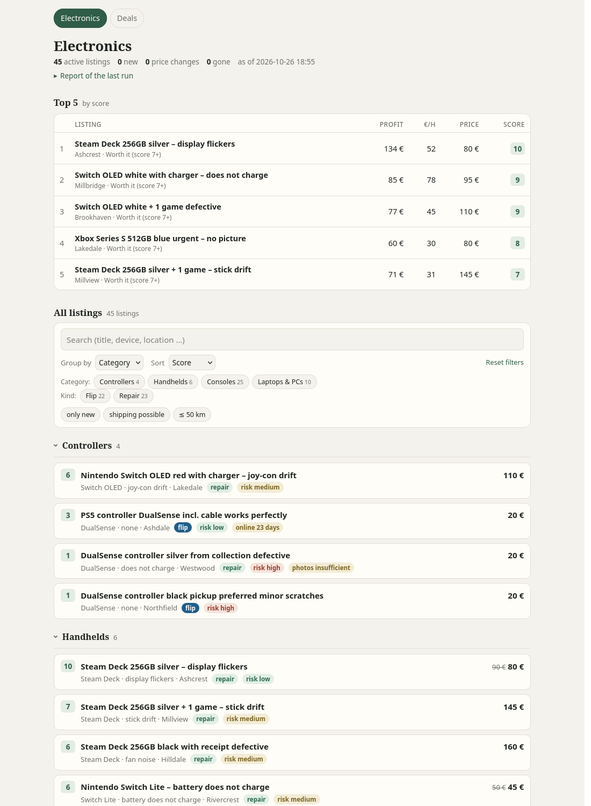
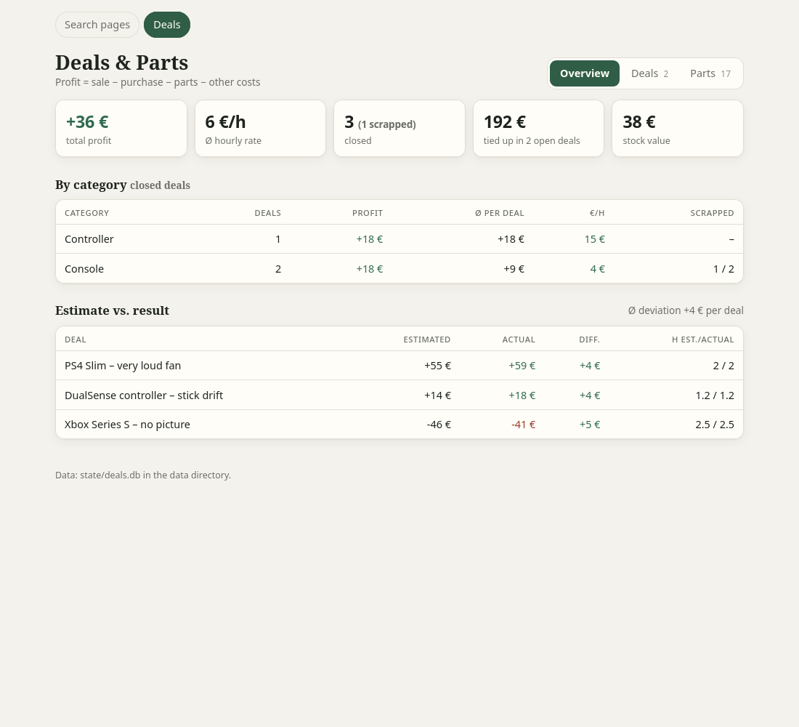
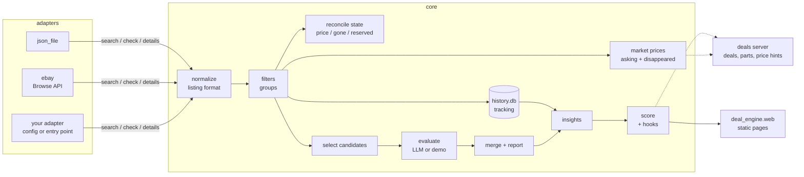

# deal-engine

A small, self-hosted engine for finding second-hand deals: it collects listings from sources you
connect, keeps a state per search (new listings in, gone listings out, price changes), estimates
market prices from asking prices and from listings that disappear, lets an LLM evaluate new
candidates, and turns the evaluator's numbers into a score with profit, profit per hour and a
negotiation hint. A static page per search and a small deal/parts tracker show the result.

It started as a private tool for repairing and reselling used electronics. This repository is
the platform-neutral core of it: **no scrapers are included**. Listings come in through
adapters; two ship with it — the official eBay Browse API and a plain JSON file. Your own
adapters, filters, language, prompts, page layout and score adjustments plug in from the outside
(see [Extending deal-engine](#extending-deal-engine)).



## Quick start (demo, no accounts or keys needed)

```sh
pip install -r requirements.txt
make demo
```

`make demo` generates an invented market (nothing in it comes from a real marketplace),
simulates 21 days with new listings, price cuts, reservations and listings that disappear, runs
the full pipeline once per simulated day with a rule-based stand-in for the LLM, seeds the deal
list, and serves everything on <http://127.0.0.1:8081/>:

- <http://127.0.0.1:8081/electronics/> – search page
- <http://127.0.0.1:8081/deals/> – deals, parts and purchases

`make demo-de` runs the same demo with the German locale into `data/demo-de` (it does not start
the server). Run the tests with `make test`.

Everything lives in the `deal_engine` package; the commands below are run from the repository
directory (elsewhere, `deal_engine` has to be importable, e.g. via `PYTHONPATH`).



## How it works



One run of a search (`python -m deal_engine run electronics`) does, per adapter:

1. **collect** (`deal_engine/core/pipeline.py`): run the configured queries, normalize every
   result into the [listing format](docs/listing-format.md), refresh market prices per group (at
   most once per `refresh_hours`), record everything in the tracking database, compare the stored
   listings with the results (price changes, reserved, gone via `check()`), and pick new
   candidates: they must pass the filters, not be known, and be cheap enough relative to the
   market median (`flip_ratio` for working units, `defect_price_ratio` for defective ones).
2. **prefilter** (optional): a cheap model drops obvious junk.
3. **evaluate**: the LLM reads the candidate batch (including downloaded photos) and writes
   its evaluation: resale price, parts, hours, risk, photo check, questions for the seller.
4. **merge**: accepted listings go into the state, a markdown report lists new / price changes /
   gone / reserved.

Then for the whole search: **classify** (optional, LLM assigns titles to market groups),
**insights** (time online, price drops, relisted items, sale price from disappeared listings,
bundles), **score**, **render**.

### Modules

| Path | Content |
|---|---|
| `deal_engine/core/listing.py` | listing model, validation, normalization, extra fields ([format](docs/listing-format.md)) |
| `deal_engine/core/filters.py` | hard filters (`passes`, numeric `fields` filters) and defect signal |
| `deal_engine/core/groups.py` | market groups: `match_group`, `bundle_qty`, `market_group`, accessories |
| `deal_engine/core/market.py` | market price estimate from asking prices, resale estimates, sale price from disappeared listings |
| `deal_engine/core/history.py` | price tracking in SQLite, checks of listings that vanished from the results |
| `deal_engine/core/insights.py` | time online, price drops, relisted, market data and bundle prices per stored listing |
| `deal_engine/core/score.py` | score formula, price ceiling, negotiation hint, message draft, score hooks |
| `deal_engine/core/classify.py` | optional LLM group assignment |
| `deal_engine/core/pipeline.py` | collect / prefilter / merge (adapter-neutral) |
| `deal_engine/core/run.py`, `deal_engine/__main__.py` | orchestration (`RunResult`) and CLI |
| `deal_engine/core/config.py` | config loading, path resolution, `ConfigError` |
| `deal_engine/core/locale.py` | language rules and texts (`en`, `de`) |
| `deal_engine/core/plugins.py` | loading `"module:attribute"` plugins and entry points |
| `deal_engine/core/llm.py` | Claude Code CLI calls and prompt loading |
| `deal_engine/core/prompts/<locale>/` | built-in `evaluate`, `prefilter` and `classify` prompts (`en`, `de`) |
| `profiles/electronics.md` | example search profile (criteria and fields for the evaluator) |
| `deal_engine/adapters/` | registry (`__init__.py`), `base.py` (interface), `json_file.py`, `ebay.py` |
| `deal_engine/deals/` | deal list, parts inventory, purchases, listing price hints |
| `deal_engine/web/render.py` | static page per search, layout from `searches.<name>.web` |
| `deal_engine/demo/` | market simulator, demo evaluator, deal seeding |

### The score

`deal_engine/core/score.py` computes, from the evaluator's numbers:

- profit = resale − purchase − parts − shipping (or pickup: km × cost, driving time counts as work)
- expected profit = success probability (by risk and photo check) × profit − failure probability × loss
- base score from expected profit per hour (piecewise linear), bonus for high absolute profit
- caps: high risk, fraud indicators (negated mentions such as "no signs of fraud" are ignored),
  photos worse than described, no market data, reserved, and never more than one point above the
  evaluator's own score
- the highest purchase price that still reaches `target_score` (used for the negotiation hint)

All weights are configurable (`score:` in a search, `shipping:` globally). Score hooks can adjust
the result afterwards (see [Score hooks](#score-hooks)).

## Configuration

Copy `config.example.yaml` to `config.yaml`. It holds your location (for distances and shipping
estimates – the example values are a placeholder), the shipping model and fees, LLM settings,
and one block per search: adapters, filters, market groups, score parameters, page layout.

The config is looked up as `--config PATH`, `$DEAL_ENGINE_CONFIG`, `./config.yaml`,
`./config.example.yaml` (`./` is the current working directory). Relative paths inside it
(`data_dir`, `profile`, `json_file.path`, `prompts`, `plugin_paths`, `web.root`) are relative to
the config file; `{data_dir}` expands to the data directory.

```sh
python -m deal_engine run                    # all searches, evaluation with the Claude Code CLI
python -m deal_engine run electronics        # one search
python -m deal_engine run --json result.json # also write the structured results
python -m deal_engine score electronics --show
python -m deal_engine render                 # render the search pages
python -m deal_engine history electronics    # tracking statistics per group
python -m deal_engine validate listings.json # check a listings file
python -m deal_engine adapters               # adapters this config can use, and where they come from
python -m deal_engine.deals.deals_server --web-root data/web
```

`--web-root` of the deal server is relative to the working directory.

The LLM steps call the [Claude Code](https://docs.claude.com/en/docs/claude-code) CLI in print
mode (`claude -p`) with only the Read/Write tools, because the evaluator has to read the
candidate file and photos and write one result file. Command and arguments are configurable
under `llm:`. Each call gets `--tools` (only Read/Write exist for the evaluator, no tools for
classification), `--allowedTools` and, by default, `--strict-mcp-config --mcp-config '{"mcpServers": {}}'`
so that no MCP servers are loaded. Your own Claude Code settings and hooks still apply to these
runs. If the CLI is not available, the evaluation step fails and is reported as a problem in the
run report; collecting, tracking and market prices still work.

What has actually been run (Claude Code 2.1.310, model `haiku`, 5 defective demo listings, no
photos): evaluation of a batch of 3 candidates (about 35–55 s) and classification of 5 titles
(about 13 s), twice; the result files were valid JSON both times and were merged into the state.
Larger batches, photos and other models have not been tried in this repository. This was done
with 0.1.x and has **not been re-run for 0.2.0** (new package layout, prompts moved to
`deal_engine/core/prompts/<locale>/`, German prompts).

## Extending deal-engine

Everything below works without editing deal-engine. Plugins are given as `"module:attribute"`;
the module must be importable — installed, or in a directory listed under `plugin_paths`
(relative to the config file).

### Adapters

An adapter name is resolved in this order: the config, an entry point, built in (`json_file`,
`ebay`). There is no fallback: an unknown name, or an adapter that cannot run with the given
configuration, makes that adapter fail with a configuration error.

By config:

```yaml
plugin_paths: [plugins]                    # ./plugins next to config.yaml
adapters:
  csv_export: "my_adapters.csv_export:CsvExportAdapter"
searches:
  bikes:
    adapters: [csv_export]
    csv_export:                            # settings of the adapter (self.settings)
      path: exports/bikes.csv
      max_new_per_run: 20                  # overrides the search's max_new_per_run for this adapter
```

By entry point, from an installed package:

```toml
[project.entry-points."deal_engine.adapters"]
csv_export = "my_adapters.csv_export:CsvExportAdapter"
```

`python -m deal_engine adapters` lists every name with its origin (`built in`,
`entry point …`, `config …`). An adapter registered under a different name than its class's
`name` uses the registered name for state ids and settings.

#### The interface

Subclass `deal_engine.adapters.base.Adapter` (see its docstring):

| Method | Returns |
|---|---|
| `search(query)` | list of listings in the [listing format](docs/listing-format.md); `query` is `{"keyword", "min_price", "max_price"}`, `keyword` `None` = everything the adapter is configured for |
| `check(source_id)` | `(status, price)`: status `active`, `reserved`, `gone` or `unknown` (the check itself failed), price the current price or `None`. A plain status string is still accepted. Prices from `check()` update the state and the tracking database |
| `details(item, max_images)` | optional: dict merged into the candidate (`description`, `images`, `attrs`, more fields), or `{"reject": "reason"}` to drop it before evaluation |
| `fetch_image(url)` | optional: bytes of one photo or `None`, fetched with the adapter's own rate and headers; without it the pipeline downloads photos itself. Either way only JPEG, PNG, WebP and GIF are kept |

Raise `deal_engine.adapters.base.Blocked` when the source refuses further requests (rate limit,
quota): the run stops for this adapter and is reported as partial. Raise
`deal_engine.core.config.ConfigError` in `__init__` when the adapter cannot run with the
configuration (missing credentials or settings). Count your requests in `self.requests`.

An example for an invented source — a CSV file you exported yourself; it fetches nothing:

```python
# plugins/my_adapters/csv_export.py
import csv

from deal_engine.adapters.base import Adapter
from deal_engine.core.config import ConfigError, resolve


class CsvExportAdapter(Adapter):
    """Listings from a CSV export (columns: id, title, price, km, status)."""
    name = "csv_export"

    def __init__(self, cfg, sc):
        super().__init__(cfg, sc)                         # self.settings = sc["csv_export"]
        if not self.settings.get("path"):
            raise ConfigError(f"search '{sc['_name']}': csv_export.path is not set")
        self.path = resolve(self.settings["path"], cfg)   # relative to the config file

    def _rows(self):
        self.requests += 1
        with open(self.path, newline="") as f:
            return {r["id"]: r for r in csv.DictReader(f)}

    def search(self, query):
        kw = (query.get("keyword") or "").lower()
        return [{"source_id": r["id"],
                 "url": f"https://example.invalid/item/{r['id']}",
                 "title": r["title"],
                 "price": r["price"],                     # strings like "4.200" are parsed
                 "km": int(r["km"]) if r["km"] else None, # extra field, see below
                 "status": r["status"] or "active"}
                for r in self._rows().values() if kw in r["title"].lower()]

    def check(self, source_id):
        r = self._rows().get(str(source_id))
        if r is None:
            return "gone", None
        return ("reserved" if r["status"] == "reserved" else "active"), r["price"]

    def details(self, item, max_images=1):
        if "swap only" in item["title"].lower():
            return {"reject": "swap only"}
        return {}
```

Register it with the config block above (or the entry point). Read [Data sources](#data-sources)
before connecting anything real.

### Extra fields and field filters

Any listing field whose name is lowercase letters, digits and underscores (`km`, `year`, `ps`, …)
and whose value is a number, a short string or a bool is kept as a real field: it goes into the
evaluation batches and the state, and numeric filters can use it (also on `attrs`). Stored
listings that no longer pass leave the state as "no longer matches the criteria".
Details in the [listing format](docs/listing-format.md#extra-fields).

```yaml
filters:
  fields:
    km: {max: 60000}
    year: {min: 2010, missing: fail}   # without a value the listing fails (default: passes)
```

### Category quotas

```yaml
category_caps:
  - {name: phones, regex: "iphone|galaxy|pixel", max_new_per_run: 5, max_share: 0.2}
```

At most `max_new_per_run` new candidates per run whose title matches `regex`, and with
`max_share` at most `int(max_share × (state size + max_new_per_run)) − matching entries in the state`
new ones. This is an approximation that keeps a small state from being blocked; the real share can end
up somewhat higher. The rest is postponed.

### Locale

`locale: de` globally or per search (default `en`). A locale covers bundle quantities
("3 Stück", "drei Controller"), "inkl./mit" clauses for accessory detection, default accessory
and market-exclude words, fraud indicators and their negations ("keine Vorkasse"), stop words for
relist detection, and the texts deal-engine writes: report, score calculation, negotiation hint,
message draft, insights, price hints, parts block, page texts and field labels. It also selects
the built-in prompts. Machine values in the state stay English in every locale (`deal_type`
repair/flip, `risk` low/medium/high, `photo_check`, status `reserved`); only what is shown is
translated.

### Prompts

```yaml
prompts:                     # globally, or inside a search (search wins)
  evaluate: prompts/bikes-evaluate.md
  prefilter: prompts/bikes-prefilter.md
  classify: prompts/bikes-classify.md
```

Without an override the built-in prompt for the locale is used
(`deal_engine/core/prompts/{en,de}/`). The search's `profile` is put in front of the evaluate and
prefilter prompts. Placeholders: `{{CANDIDATES}}`, `{{ACCEPTED}}`, `{{DATE}}` (evaluate),
`{{CANDIDATES}}`, `{{PREFILTER}}` (prefilter), `{{GROUPS}}`, `{{TITLES}}` (classify), and
`{{WANTED_ADS}}` in evaluate and prefilter.

### Wanted ads

`wanted_ads: reject` (default) or `accept` per search. `{{WANTED_ADS}}` becomes the locale's rule
for it: `reject` tells the evaluator to discard wanted, buying, swap and rental ads; `accept` is
for searches that look for wanted ads (dealers' "we buy everything" ads are still discarded).

### Page layout

`searches.<name>.web` defines the static page of a search; a search without it gets a generic page
(score, price, location). Keys: `slug`, `title`, `tiers`, `columns` (`{label, field, format:
eur|int|text}`), `meta`, `badges` (built in: `deal_type`, `risk`, `photo_check`,
`shipping_unknown`, `auction_end`, `parts_in_stock`, or `{field, label: "text {value}", class:
ok|bad|unk|new, when}`), `sorts` (`{label, field, desc}`, the first is the default), `facets`
(`{key, field}` or regex categories `{key, from, rules: [[label, regex], …], other}`), `groups`,
`chips`, `orders`, `toggles` (`{key, label, field}` with `equals`, `min` or `max`) and
`deal_link`. Labels are plain text or one text per locale (`{en: Profit, de: Gewinn}`); a missing
label is the locale's field label. A setting with a clearly wrong type stops with a configuration
error naming the key. `config.example.yaml` has the full electronics page; a sketch for
motorbikes whose profile returns `touring_score` and `gravel_score`:

```yaml
motorbikes:
  web:
    columns:
      - {label: Touring, field: touring_score, format: int}
      - {label: Gravel, field: gravel_score, format: int}
      - {field: km, format: int}
    meta: [year, km, location]
    sorts:
      - {label: Score, field: score, desc: true}
      - {label: Touring, field: touring_score, desc: true}
      - {label: Gravel, field: gravel_score, desc: true}
      - {label: Price, field: price}
    toggles:
      - {key: a2, label: A2 license, field: ps, max: 48}
```

### Score hooks

```yaml
score:
  enabled: true
  hooks: ["my_hooks:mileage"]
```

```python
# plugins/my_hooks.py
def mileage(listing, info):
    # info: score, exact, computed (formula or evaluator score), caps (e.g. "high_risk",
    #       "fraud", "ai_gap"), notes, settings, locale
    if (listing.get("km") or 0) > 80000 and info["score"] > 5:
        return {"score": 5, "note": "high mileage: max 5"}
    return None                           # nothing to change
```

Hooks run after the calculation for every listing, in order. The returned score is clamped to
1–10 and rounded; the note is appended to the score calculation. The tier (A ≥ 7, B ≥ 5, else C)
follows the final score. A hook that raises is logged and skipped.

### Structured results

`run_search()` (`deal_engine/core/run.py`) returns a `RunResult` with one `AdapterResult` per
adapter: `status` `ok`, `partial` (blocked, an evaluation batch failed, other problems) or
`failed` (`reason` `config_error` or `error`), plus `error` and counts (`found`, `candidates`,
`rejected`, `postponed`, `added`, `merged`, `price_changes`, `gone`, `requests`, `problems`).
`bool(result)` is true only if every adapter is `ok`. `python -m deal_engine run --json PATH`
writes these results as JSON.

Exit codes of `python -m deal_engine`: **0** ok, **1** an adapter had problems or failed,
**2** configuration error (e.g. unknown adapter, eBay without credentials).

## Data sources

deal-engine does not fetch anything by itself; adapters do. **You are responsible for making
sure that your use of any data source complies with its terms of service, its API license,
robots rules and the law that applies to you** (including copyright, database rights and data
protection). In particular:

- Prefer official APIs and feeds over anything else.
- Do not work around access restrictions: no captcha solving, no evasion of rate limits or bot
  protection, no logins you are not entitled to, no rotating identities.
- Keep request volumes low; the adapter interface is built around a few queries per run.
- Store item data only. Do not collect personal data of sellers; the listing format has no
  fields for it.

Adapters for platforms without an official API are out of scope for this repository.

### eBay

`deal_engine/adapters/ebay.py` uses the official [Browse API](https://developer.ebay.com/api-docs/buy/browse/overview.html)
with an application token (client credentials). You need your **own** key set from the eBay
Developers Program (`EBAY_CLIENT_ID`, `EBAY_CLIENT_SECRET` in the environment), and your use must
comply with the **eBay API License Agreement** and the call limits of your key. The adapter
stores item data only (title, price, condition, shipping cost, item location, item number,
description, images, item aspects) and no user data (no seller name, user id or feedback).
Without `EBAY_CLIENT_ID`/`EBAY_CLIENT_SECRET` the run reports a configuration error for the eBay
adapter (`failed`, reason `config_error`, exit code 2); nothing falls back to another source.
Other adapters of the same search still run.

Live check (writes nothing; credentials only from the environment):

```sh
python -m deal_engine.adapters.ebay "your search" --markets EBAY_DE --limit 5 [--country DE --zip 10115]
```

It requests a token, runs one search per marketplace, prints the items, and calls getItem and
`check()` for the first one.

**Verified against the live API on 2026-10-26** with this probe (EBAY_AT and EBAY_DE, 5 items
each): the client-credentials token, the search on both marketplaces (5 items each, with price,
shipping cost, condition and item location), getItem for one item (description, 6 images,
9 aspects, item location) and `check()` (returned `active`) all worked, with 4 API requests
in total. This verification was done with 0.1.1 (then `python -m adapters.ebay`). A full
`python -m deal_engine run` with the eBay adapter (state, candidates, evaluation) has not been
run against the live API.

Shipping costs: in that probe, 2 of 10 items had no shipping cost in the search result. A missing
cost is treated as unknown, never as 0: the item is marked `shipping_unknown` with the note
"shipping unknown, assumed 15 €", and `shipping.unknown_cost` (default 15 €) is used for the
candidate selection and the score. A stated cost of 0 counts as free shipping.

## Limitations

- **Asking prices are not sale prices.** The market estimate is a median of asking prices,
  reduced by `sale_factor`. The "sale price" from disappeared listings is an assumption, too:
  a listing that disappears may have been sold, but also deleted or relisted elsewhere.
- **The score is a heuristic.** It is only as good as the evaluator's numbers (resale price,
  parts, hours, risk), and its weights reflect one person's repair-and-resell use case.
- **Regex rules are language- and market-specific.** Groups, filters, accessory and bundle
  detection come with English defaults and have to be adapted to your market. The German locale
  rules are regex word lists as well and need tuning for real listings.
- The deal list page (`deal_engine/deals/deals.html`) is English, also with `locale: de`; only the price
  hints and the parts block from the server are translated, so a German setup shows a mixed page.
- **LLM evaluations can be wrong**, also on photos, and differ between runs (the same 3 demo
  candidates: 1 of 3 accepted in one `haiku` run, 0 of 3 in the next). The automated tests use a fake
  command; the real CLI was only run manually as described above, with 0.1.x.
- The eBay adapter is verified only with the probe described above (token, search, getItem,
  check), not in a full pipeline run against the live API.
- Without a photo URL, relist detection is text-based (same source and place, same group, price
  within ±15 %, similar title). Two different items with generic titles from the same place can
  still be taken for one.
- The deal server has no authentication and binds to 127.0.0.1. Put authentication in front of
  it before exposing it anywhere.

## License

MIT, see [LICENSE](LICENSE).
